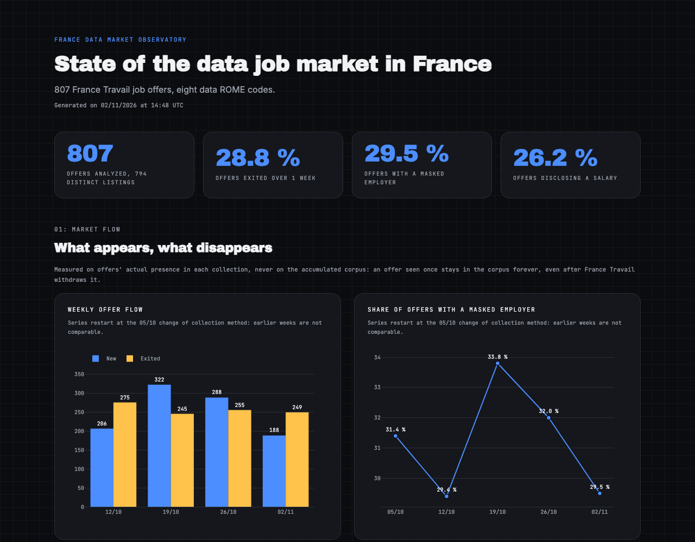

# France Data Market

A dbt + DuckDB pipeline that collects French data-job postings from the France Travail API every week, enriches them with company data (SIRENE) and a local-LLM skill extraction, and publishes a market report.

**Every non-trivial choice below is backed by a measurement on real data, not a guess.**

**[→ Open the live report](https://ricksan37.github.io/france_data_market/)** (regenerated every Monday by GitHub Actions)

[](https://ricksan37.github.io/france_data_market/)

## Context

I built this project to learn Analytics Engineering on a real, messy public dataset. Every figure on this page describes **France Travail listings only, not the whole French data market**. On the 5 October pull, 37% of listings come from intermediaries, 32% hide the employer and 31% come from direct employers, so the dataset leans towards agencies and consultancies.

## Data

Measured on the pull of 5 October 2026: 792 distinct listings (814 offers) returned by eight France Travail ROME-code searches (M1405 data scientist, M1811 data engineer, M1419 data analyst, M1868 data architect, M1851 BI analyst, M1824 BI developer, M1872 BI consultant, M1423 chief data officer). Keyword searches were dropped on 2026-09-29 and earlier pulls were truncated (see the history break below), so neither is comparable with these figures. The LLM skill extraction does not run on this pull, as in the weekly report: employers whose text reveals a masked end client are not reclassified and count as masked.

**Qualifying what is a data job.** ROME codes are declared by recruiters and collect wide: they also bring in business developers, system architects and data center jobs. `is_data_job` in `fct_job_offer` restores precision from the job title: 571 of 792 listings (72.1%) qualify. Measured on 100 random listings labelled before scoring the rule: precision 100% (75 of 75), recall 94.9% (75 of 79). With that sample, true precision is at least about 96%, and there was no independent annotator. `exploration/check_qualification.py` reproduces the measurement from `data/qualification_labels.csv`. The findings below and the live report cover all collected listings, not only qualified ones.

## Approach

**Company matching went from 19.2% to 80.3%.** The first attempt (name + postal code) matched one offer in five. Eleven diagnostic rounds later, each triggered by a measurement on real data, the rate reached 80.3% on the 213 eligible offers. Two rules that *worked* were later removed because they produced false positives: the rate gained more in reliability than in volume. Re-run in September on the full corpus with the same rules: 86.8% (614 of 707), and unchanged on the July offers (171 of 213).

**The geographic key wasn't what I assumed, and I only half-fixed it.** The original plan used postal code to join company data. Measured on the 213 July offers: postal code covers 166, INSEE commune code covers 198, a strict superset. I fixed the company enrichment, but not the geography dimension, which stayed indexed on postal code alone. Paris, Lyon and Marseille are the three French communes with arrondissements: they have no single postal code, so the source returns their overall INSEE code instead, with an empty postal code. Measured on the 5 October pull: 154 offers affected, 131 of them in Paris; a postal code index would show 73 Parisian offers instead of 204. The key is now the INSEE commune code, which takes coverage from 74.0% to 92.6%. The lesson wasn't "fix this one join," it was "this source's geographic key isn't the postal code", and I'd only applied it locally the first time.

**Three local LLMs, compared on a real task.** To extract technical skills from free-text listings, three models ran locally (Ollama) on the same prompt and reference offer: Mistral 7B, Qwen3 8B and Mistral-Nemo 12B. Only Nemo reliably told a named product (Azure, Databricks) apart from a technical concept (RAG, CI/CD). The model was picked on that measurement, not its reputation.

**My own fact table was measuring the wrong thing.** `fct_job_offer` once unioned every collected dump and deduplicated: correct for a corpus, wrong for a market reading, because an offer seen once stayed in it forever. Two fact tables came out of it: `fct_weekly_market` counts each week's pull (`fct_job_offer` now holds the latest dump only), and `fct_weekly_market_flow` measures actual presence in each pull (`offer_presence.csv`) and is the only table that can say what appears and disappears. The test that keeps it honest ties independently computed measurements together: a week's active offers must equal the previous week's, minus exits, plus entries (`816 - 275 + 210 = 751` for the week of 12 October).

**Invisible on the aggregate, destructive on a slice.** On the cumulative corpus of early September 2026, fifteen offers out of 275 carried an implausible annual salary: eleven at €1,800, four between €15 and €40 an hour mislabeled as annual. On the overall median they changed nothing (€45,000 either way). On a slice, they inverted it: offers mentioning Tableau showed a median of €1,800 instead of €37,000. All eleven €1,800 offers were also classified `ANONYMOUS`, creating a fake €5,000 gap against `DIRECT_EMPLOYER`. A flag (`annual_salary_plausible`), not a silent reclassification, excludes them without destroying the value. The 5 October pull has one such offer out of 186.

**Counting offers vs. counting listings.** Deduplication catches the API's own index duplicates, not campaigns: the same position posted in several cities gets one identifier per city. On the 5 October pull, 33 offers out of 814 fall into 11 clusters of identical text, so 814 offers make 792 listings. Nothing is deleted: a `cluster_size` / `is_canonical_listing` pair exposes the choice, and the report gives both counts.

## Results

1. **Offers are short-lived.** Of the 816 offers live on 5 October 2026, 33.7% had left France Travail a week later, 55.0% after two weeks, 70.6% after three and 78.7% after four; only 2 came back. Speed depends on who posts: after four weeks, 96.6% of Collective.work offers had gone, against 83.5% for direct employers, 76.8% for agencies and consultancies and 64.5% for masked employers. Leaving France Travail doesn't prove a position was filled. An earlier figure (84% after six weeks) was withdrawn: it came from truncated pulls, see the history break below.
2. **Salaries are rarely shown, and almost never when the employer is hidden.** 25.8% of listings disclose a salary: 45.0% for recruitment agencies and IT consultancies (Collective.work excluded, see finding 4), 37.7% for direct employers, 8.3% when the employer's name is masked (about 1 listing in 3).
3. **Where a salary is shown, it sits in a narrow band.** The median annual salary (lower bound) is €45k for direct employers (n=74) and masked employers (n=19), €43k for agencies and consultancies (n=54), €50k for Collective.work missions (n=23). Required experience is what moves it: €45k when experience is required (n=131) vs €40k when beginners are accepted (n=39).
4. **Nearly a fifth of the market is freelance missions from a single platform.** Collective.work, which relays missions for unnamed clients, posted 144 of the 792 listings (18%), all created from 11 September. They rarely fill the salary field (16%) and state a daily rate in the text instead (53 listings mention a TJM), so they're counted as intermediaries and left out of the agency figure above.
5. **Data engineers lead, and analytics engineers barely appear.** Among the 571 qualified listings, 24.3% of titles name a data engineer, 17.2% a data analyst, 15.1% a data scientist, and only 9 listings (1.6%) an analytics engineer.
6. **SQL is named in under half of the listings, and no platform dominates.** SQL appears in 47.3% of descriptions, Python in 41.3%, Power BI in 25.0%, dbt in 11.0%. Cloud is split between GCP (15.1%), Azure (14.5%) and AWS (11.2%), platforms between Snowflake (12.1%), Databricks (11.9%) and BigQuery (9.8%). These are text searches, so they count what a listing names, not what the job uses.
7. **Mostly permanent contracts, mostly around Paris.** 62.2% of listings are permanent (CDI), 18.0% self-employed missions (almost all from Collective.work), 10.2% temporary agency work, 9.6% fixed-term. 51.8% are in Île-de-France, 27.5% in Paris itself; 36 listings give no commune.

`exploration/market_figures.py` recomputes findings 1 and 5 to 7.

## Limits and next steps

- **France Travail API cap**: 1,150 results per search. Beyond that, the search would need narrowing (e.g. by date).
- **History break on 2026-09-26: pulls before it were truncated.** Until then, pagination sent its range in an HTTP `Range` header, which the France Travail API silently ignores: every "page" was the same first 150 offers. The duplicates this produced within a category (449 of the 542 in the July dump) were long read as live-index noise and deduplicated away, which hid the bug. Pagination now uses the `range` query parameter, and `full_pull.py` fails before writing any dump if a category fetches fewer unique offers than the API's `Content-Range` total (tolerance: max(5, 2%)). Consequences: `offer_presence.csv`, `fct_weekly_market_flow` and `weekly_market.csv` are **not comparable before and after 2026-09-26** (every week up to 2026-09-21 is truncated). `fct_job_offer` holds the latest dump only, so the truncated dumps no longer enter it. Two later breaks are flagged in `series_breaks.csv`: 2026-09-28 (first untruncated pull of the series) and 2026-10-05 (first pull on the eight-ROME-code scope, and first total measured on the latest dump only).
- **Company enrichment can lag the pull.** `enrich_dinum.py` runs every Monday after the snapshot, in a step allowed to fail (`continue-on-error`). `stg_dinum__companies` keeps the most recent dump, and `assert_match_status_valid` rejects a dump containing an API failure (`technical_error`), as does a matching rate under 75 %: the report then goes out with the SIRENs of the versioned dump, and offers collected since have none until the next successful run.
- **"EY" left unmatched** (5 offers in the 2026-10-05 pull): a commercial acronym absent from the SIRENE registry, with 5+ legal entities and no reliable tiebreaker.
- **Group consolidation on homonyms** (23 offers of the 5 October pull, on the latest local DINUM dump): subsidiaries sharing a name with their parent are attached to the largest entity, a deliberate choice aligned with the analytical goal, flagged with a distinct status.
- **LLM extraction under-extracts the `domains` field** on consulting listings, in exchange for much higher reliability on `technologies`, the field prioritized for this project.
- **Salary plausibility bounds, annual only**: too few hourly/monthly offers (6 and 27 in the 5 October pull) to set a defensible threshold.
- **Salary shown on under a third of listings** (25.8% in the 5 October pull): any salary analysis covers a non-random subset, since disclosing a salary is itself an employer behavior.
- **Residual near-duplicate listings**: detection relies on strict text identity; listings differing by a few words are counted separately.
- **ROME tags are declared by recruiters**, so they collect wide. `is_data_job` corrects this from the title alone: a title with no data term stays false even when the description is about data.
- **Three extracted fields keep formatting defects**: `education_level`, `remote_work` and `salary_text`. No mart or report reads them, so they stay in staging, not normalized.
- **Latest pull vs. presence history are two different things**: `fct_job_offer` and `fct_weekly_market` describe each week's pull; `fct_weekly_market_flow` is the only one that measures what appears and disappears between pulls.

The project is closed. The weekly workflow keeps the live report up to date, and no new feature is planned: the report stays a static HTML page, and the domain mapping stops at 17 clusters covering 30.7% of mentions.

Following the market I actually target moves to a separate project, not named yet: France Travail listings don't show the positions at the SaaS companies I'm aiming for. On the 5 October pull, 27 of 792 listings (3.4%) come from SMEs or mid-sized companies under 10 years old, IT consultancies included. That is an order of magnitude: 114 listings from direct employers have no company data. That project will compare these results with SaaS job postings on the same indicators (roles, stack, contracts), to show how far France Travail is from that market.

## Reference

### Repository layout

The Python scripts at the root are the pipeline's stages and their helpers (ingestion, enrichment, extraction, snapshots). The 25 scripts in `exploration/` are diagnostic scripts, kept for traceability.

### Architecture

```
France Travail API ──► full_pull.py ──► data/raw/job_offers_*.json ─┐
                                                                         │
DINUM API ──► enrich_dinum.py ──► data/raw/enrich_dinum_*.json ────────┤
                                                                         │
Local LLM (Ollama) ──► extract_skills.py ──► data/raw/extract_skills_*.json ┤
                                                                         ▼
                                                                  dbt sources
                                                                         │
                                                                    staging
                                                                         │
                                                                  intermediate
                                                                         │
                                                                      marts
```

dbt makes no HTTP or LLM calls. Every enrichment follows the same pattern: standalone Python script → timestamped JSON dump in `data/raw/` → dbt source → `stg_` model.

#### dbt layers

- **staging** (`stg_`): renaming, casting, deduplication. No business logic.
- **intermediate** (`int_`): salary parsing and plausibility, employer classification, identical-listing clustering, placement of LLM-extracted skills between technologies and domains.
- **marts**: `fct_job_offer` (grain: one offer), `dim_rome`, `dim_commune`, `dim_company`, `fct_job_offer_technology`, `fct_job_offer_domain`, `fct_weekly_market` (each week's pull) and `fct_weekly_market_flow` (presence history: what appears and disappears).

### Continuous integration

Two workflows. `.github/workflows/ci.yml` runs on every push and pull request: compiles the Python scripts, rebuilds the full dbt graph with its tests, generates the report. A second job scans the full git history for secrets with gitleaks (the repository is public). **No secret required**: the reference dumps and snapshot CSVs are versioned, so the pipeline rebuilds from the repo's own data alone. `.github/workflows/weekly_pull.yml` runs every Monday: ingestion, presence history, build, snapshot, DINUM enrichment, report, commit, then deploys the report to GitHub Pages. The runner only has the versioned 2026-10-05 dump plus that week's pull (earlier weekly dumps aren't kept), and `stg_raw__ft_job_offers` keeps the most recent dump, so the live report describes that week's pull. The weekly presence history (`offer_presence.csv`) is committed, so it carries over from week to week (see the history break below).

The versioned reference dump is stripped of the `contact` and `agence` fields (recruiter names, emails, phone numbers): France Travail's reuse licence excludes contact data, and `full_pull.py` now drops them at ingestion. Job descriptions are kept exactly as the API returns them.

The weekly run can't execute the LLM extraction (Ollama doesn't run on a GitHub runner), so an env var (`CI_WITHOUT_EXTRACTION`) makes the extraction source degrade to zero rows with the same schema. The affected metrics are marked explicitly unavailable rather than silently zero.

### Setup

```bash
git clone <repo>
cd france_data_market
python3 -m venv .venv
source .venv/bin/activate
pip install -r requirements.txt
```

Create a `.env` file at the root (never committed) with France Travail partner credentials:

```
FT_CLIENT_ID=xxxxxxxx
FT_CLIENT_SECRET=xxxxxxxx
```

No API key is needed to reproduce the dbt layer: `profiles.yml` is versioned, DuckDB needs no credentials, and skill extraction runs on a free local model.

```bash
cd france_data_market
dbt debug
dbt run
dbt test
```

### Usage

```bash
python3 full_pull.py        # France Travail ingestion
python3 enrich_dinum.py        # SIRENE/DINUM company enrichment (needs a prior dbt run)
ollama pull mistral-nemo
python3 extract_skills.py      # skill extraction, incremental resume, ~34s/offer
python3 offer_presence.py      # weekly presence history, idempotent
python3 weekly_snapshot.py      # weekly corpus snapshot, upsert
python3 dashboard/generate_report.py   # static HTML report
```

Each run produces a distinct timestamped file: nothing is overwritten.

### Stack

| Component | Version | Why |
|---|---|---|
| dbt | 2.0.6 | dbt v2, the Rust engine; it embeds its DuckDB driver. |
| DuckDB | 1.5.5 | In-process columnar OLAP, zero-copy Arrow/Pandas. The pipeline runs in seconds on a laptop, no server to provision. |
| Ollama + Mistral-Nemo 12B | | Structured skill extraction, locally. No API key, no cost. |
| GitHub Actions | | Weekly pull automation. Disposable runner: only the aggregated snapshot persists between runs. |
| Python | 3.13 | requests, python-dotenv, duckdb, pydantic, ollama, plotly |
